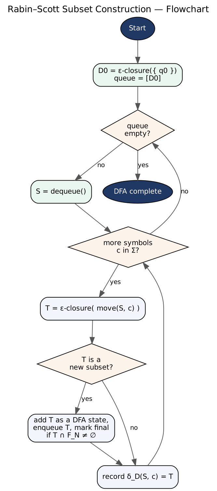
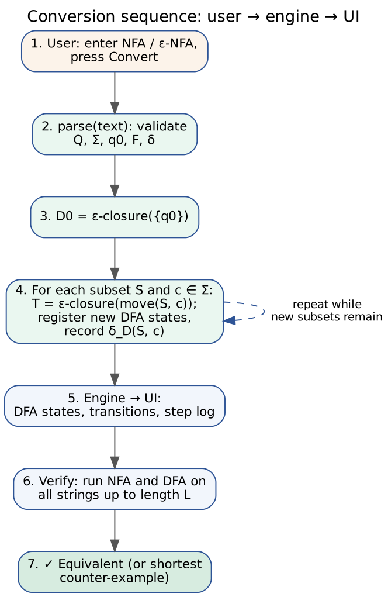

# Automata Studio — ε-NFA → DFA Subset Construction Simulator (Group 03)

**Group 03 (Tutorial Batch T-12) · CSET302 — Automata Theory and Computability · Bennett University (SCSET)**  
**Milestone-II: Final Simulator Demonstration & Evaluation (23–27 November 2026)**  
**Live Production URL:** [https://automata-simulator-ashen.vercel.app/subset.html](https://automata-simulator-ashen.vercel.app/subset.html)

---

## Overview: What does the simulator do?

**Automata Studio** is a zero-dependency, interactive web simulator that converts an
**ε-NFA** — a non-deterministic finite automaton with ε (empty-string) transitions, of
which an ordinary **NFA** is the special case with no ε-moves — into an equivalent
deterministic finite automaton (**DFA**) using the **Rabin–Scott powerset / subset
construction** algorithm. The step that makes this an *ε-NFA* converter (rather than a plain
NFA one) is the **ε-closure**: the start state is ε-closure({q0}) and every transition is
ε-closure(move(S, a)), so states reachable "for free" on ε are always included.

The simulator is built for teaching and for Milestone-II evaluation: it does not just
print the final DFA, it *shows the construction happening*. For every step it displays the
subset being processed, the `move` on each input symbol, the resulting **ε-closure**, and
whether a brand-new DFA state has been discovered — with the source NFA and the growing DFA
drawn side by side and a working table that fills in cell by cell.

After conversion, the engine automatically **verifies correctness**: it checks that the
original NFA and the constructed DFA accept exactly the same strings up to a bounded length,
giving immediate evidence that the conversion preserves the language.

---

## Visual demonstration

A small **ε-NFA** (for the language `a*b`) and the DFA the tool builds from it. The ε-move from
q0 to q1 (dashed) is why the DFA start state is the ε-closure `{q0,q1}` rather than just `{q0}`.

| Source ε-NFA | Subset-constructed DFA |
|:---:|:---:|
|  |  |
| An ε-NFA for `a*b` — note the dashed ε-transition q0 → q1 and the accepting double-ring q2. | The equivalent DFA: D0 = ε-closure({q0}) = {q0,q1} (start), D1 = {q2} (accepting), D2 = ∅ (dead). |

In the live tool these are drawn side by side and animated step by step — the NFA lights up the
states in each subset while the DFA grows beside it, with a working table and a play / step / speed
transport (see the sequence diagram below for the exact flow).

---

## Architecture & diagrams

**System architecture (block diagram).** Three layers — input & parsing, the core engine,
and the interactive presentation — with the Node.js server exposing a REST conversion endpoint.

<p align="center"></p>

**Subset construction (flowchart).** The exact control flow of the Rabin–Scott algorithm as
implemented in `build()`.

<p align="center"></p>

**Conversion sequence.** How a request flows from the user through the engine to the UI:

<p align="center"></p>

---

## Supported features: list implemented operations

* **Flexible NFA / ε-NFA input** — plain transition lines (`q0,a = q0,q1`), delta notation
  (`δ(q0,a) = {q1}`) and arrow notation (`q0 -a-> q1`); ε-moves written as `ε`, `e` or `eps`.
  Optional `states:` / `alphabet:` declarations are validated when present.
* **A built-in table editor** and a **Random** example generator for quick input.
* **Draw it by hand** ("Draw" tab) — an interactive canvas where you place state circles, drag them around, draw transition wires between them (including self-loops and ε-moves), and mark the start and accepting states. The drawing is turned into the automaton the converter runs on.
* **Build an NFA from a plain-English language description** ("From a question" tab) — understands *ending with* / *starting with* / *containing* a pattern, *even/odd number of* a symbol, *length divisible by k*, *at least / at most / exactly n*, *not containing…*, *binary divisible by k*, and regular expressions like `(a|b)*abb`. This is a deterministic rule-based parser (no AI); it then feeds the subset-construction converter.
* **Iterative ε-closure** computation with cycle termination.
* **Explicit ε-elimination step (ε-NFA → NFA → DFA).** When the input has ε-moves, the result panel shows a *"Stage 1 — eliminate ε"* section: the equivalent NFA **without** ε-moves, built as δ′(q,a) = ε-closure(move(ε-closure(q), a)) with a state accepting iff its ε-closure reaches an original final. The DFA is then the subset construction of that ε-free NFA — mirroring exactly how the conversion is solved by hand.
* **Rabin–Scott subset construction** with a full **step-by-step stepper** (play / pause,
  step forward / back, variable speed) driven by `player.js`.
* **Stage 3: DFA Minimization (Hopcroft's Partition Refinement Algorithm)** — starting from $P_0 = \{F, Q \setminus F\}$, iteratively splits equivalence blocks on alphabet symbols until fixed-point termination to yield the canonical minimal DFA, with interactive step-by-step partition block splitting.
* **Interactive String Simulator & Execution Path Tracer** — step-by-step tape playback (`⏮`, `◀`, `▶ Step`, `▶ Play`, `⏭`), real-time narrative, simultaneous multi-branch token animations on NFA, deterministic token traversal on DFA, and instant acceptance/rejection verdict.
* **Academic Export Center** — one-click generation of LaTeX TikZ code for publications/Overleaf, Graphviz DOT syntax, standard JFLAP 7.0 `.jff` XML, and Markdown tables.
* **Side-by-side vector visualisation** of the NFA and the DFA (draggable nodes, auto-curved
  bidirectional edges, zoom / pan) rendered by `graph.js`.
* **Subset construction working table** and a complete **step log** of every `move` and
  closure performed.
* **DFA state-naming modes** — `D0, D1, D2…`, `A, B, C…`, or raw subsets `{q0,q1}`.
* **Automatic equivalence verification** — confirms the NFA and the DFA agree on all strings
  up to a computed length bound, and reports a counter-example if they ever disagree.
* **Dead / trap state (∅) handling** so the produced DFA is total.
* **Copy DFA as text** and a **shareable link** that re-opens the exact automaton.
* **REST endpoint** `POST /api/convert` and `POST /api/trace` for programmatic use (works locally and on Vercel serverless).

### Example questions you can type in the "From a question" tab

All of these are recognised by the builder (verified by the test suite). Type one, press **Build the NFA**, then **Convert**:

```text
strings over {a,b} ending with abb
strings over {a,b} starting with a
strings over {0,1} containing the substring 101
strings over {a,b} that contain aa
strings over {a,b} with an even number of a
strings over {a,b} with an odd number of b
strings over {0,1} with length divisible by 3
strings over {a,b} of length at least 2
strings over {a,b} not containing bb
binary strings divisible by 3
the regular expression (a|b)*abb
```

If a wording isn't recognised, the tab says so and suggests supported phrasings. The builder is deterministic and rule-based (no AI); non-regular languages such as aⁿbⁿ or palindromes cannot be built.

---

## Technology stack and dependencies: versions

| Component | Detail | Version |
|---|---|---|
| Language | JavaScript (pure **ES2022**), HTML5, CSS3 | Standard ECMAScript 2022 |
| Runtime | **Node.js** | **v18+** (verified on v24.16.0) |
| npm dependencies | **None** — zero external packages | 0 dependencies |
| Rendering | Native SVG / Vector Canvas | Standard W3C SVG 1.1 / HTML5 Canvas |
| Deployment | Node HTTP server / Vercel Serverless Edge | Vercel CLI 66.1.0 |

The entire project runs identically in the browser and on the Node.js server because the
core engine (`lib/automata.js`) is a universal module exported to both `window.Automata`
and `module.exports`.

---

## Installation: numbered setup commands

Only Node.js 18+ is required; there is nothing to `npm install`.

```bash
# 1. Clone the repository
git clone https://github.com/udbhav968-creator/AUTOMATA_SIMULATOR.git
cd AUTOMATA_SIMULATOR

# 2. (No dependency install needed — zero npm dependencies)
```

## How to run: exact command and entry point

```bash
node server.js
```

Then open **http://localhost:3000** in a browser and go to **ε-NFA → DFA**.
The entry point is `server.js`; on a busy port use `PORT=3001 node server.js`.

---

## Example: sample automaton definition, input and output

**Input NFA** (strings over `{0,1}` whose second-to-last symbol is `1`):

```text
start: q0
final: q2
q0,0 = q0
q0,1 = q0,q1
q1,0 = q2
q1,1 = q2
```

**Output DFA produced by subset construction:**

```text
# DFA from subset construction
states: D0, D1, D2, D3
alphabet: 0, 1
start: D0
final: D2, D3
# D0 = {q0}
# D1 = {q0,q1}
# D2 = {q0,q2}
# D3 = {q0,q1,q2}
D0,0 = D0     D0,1 = D1
D1,0 = D2     D1,1 = D3
D2,0 = D0     D2,1 = D1
D3,0 = D2     D3,1 = D3
```

A 3-state NFA converts to a 4-state DFA. The simulator animates each subset as it is
discovered and then confirms that both machines accept the same language.

The classic textbook case — strings over `{a,b}` ending in `ab` — converts like this:

<p align="center">
  
  
</p>

---

## Project structure: modules and responsibilities

```text
AUTOMATA_SIMULATOR/
├── api/
│   └── index.js          # Vercel serverless entry point (delegates to server.js)
├── lib/
│   ├── automata.js       # Core engine: parser, ε-closure, subset construction, Hopcroft minimization, tracer, exports
│   └── extract.js        # Rule-based natural language question parser & regex converter
├── public/
│   ├── index.html        # Home page + animated subset-construction demo
│   ├── subset.html       # ε-NFA → DFA subset construction visualiser (main page)
│   ├── 404.html          # Not-found page
│   ├── js/
│   │   └── subset.js     # Controller for the subset construction page
│   └── assets/
│       ├── app.css       # Styles (light / dark aware)
│       ├── shell.js      # App shell, navigation, theme, helpers (window.Studio)
│       ├── graph.js      # Interactive NFA / DFA vector graph renderer (window.GraphView)
│       ├── player.js     # Step player / transport controls (window.StepPlayer)
│       ├── editor.js     # Automaton text + table input widget (window.AutomatonInput)
│       └── favicon.svg
├── report/               # Milestone-II technical project report (md / docx / pdf)
├── screenshots/          # Numbered demonstration figures
├── server.js             # Zero-dependency HTTP server + /api/convert, /api/trace, /api/health
├── test.js               # Command-line 14-tier verification harness
├── package.json          # Project metadata (zero dependencies)
├── vercel.json           # Vercel deployment configuration
└── README.md             # This file
```

### Core engine API (`lib/automata.js`)

| Function | Purpose & Signature |
|---|---|
| `parse(text)` | Parse and validate an NFA / ε-NFA into an internal 5-tuple object |
| `closure(N, S)` / `closureDetail(N, S)` | Compute ε-closure with cycle detection; returns set, added states, and ε-edges traversed |
| `moveDetail(N, S, c)` | `move(S, c)` — the union of transitions on symbol `c` |
| `build(N)` | Rabin–Scott subset construction → DFA states, transitions and complete step log |
| `buildEpsElimination(N)` | Stage 1: Explicit per-state ε-closure and transition calculation δ′(q, a) |
| `minimizeDFA(N, M)` | Stage 3: Hopcroft's partition refinement algorithm yielding canonical minimal DFA |
| `traceString(N, M, word)` | Stage 4: Interactive execution tracer evaluating input word simultaneously on NFA and DFA |
| `dfaToTikz(N, M, mode)` | Academic Export: Production LaTeX TikZ code for papers and Overleaf |
| `dfaToDot(N, M, mode)` | Academic Export: Graphviz DOT representation |
| `dfaToJFF(N, M, mode)` | Academic Export: Standard JFLAP 7.0 XML format (`.jff`) |
| `runNFA(N, w)` / `runDFA(N, M, w)` | Execute a string on the NFA / DFA (used for automated equivalence verification) |

---

## Testing: command, test data and expected behavior

The simulator is verified at three levels:

**1. Automatic equivalence verification (built in).**
After every conversion the page runs the constructed DFA, the intermediate ε-free NFA, and the original ε-NFA on *all* strings up to a computed length bound and confirms they accept exactly the same set. The result appears as a green “✓ Verified: the NFA and the DFA agree on all N strings up to length L” message.

**2. Command-line 14-tier automated test harness.**
```bash
node test.js
```
Output on the current build:
```text
Tier 1 — functional, edge & validation tests: 12/12 passed ✓
Tier 2 — fuzzing: 300 random NFAs converted, 12,000 strings tested, 0 mismatches ✓
Tier 3 — "from a question" builder: 7/7 language descriptions built correctly ✓
Tier 4 — hand-drawn canvas builder: 3/3 drawn automata serialise and convert correctly ✓
Tier 5 — ε-elimination (ε-NFA → ε-free NFA → DFA): 3/3 pipelines language-equivalent ✓
Tier 6 — minute step-by-step ε-elimination: 3/3 pass ✓
Tier 7 — edge cases, case-insensitivity & invariants: 6/6 pass ✓
Tier 8 — Thompson regex-to-NFA equivalence: 6/6 pass ✓
Tier 9 — natural language question parser expansion: 7/7 pass ✓
Tier 10 — live HTTP server and REST API integration: 7/7 pass ✓
Tier 11 — DFA minimization (Hopcroft partition refinement): 4/4 pass ✓
Tier 12 — interactive string simulator & path tracer: 4/4 pass ✓
Tier 13 — academic exports (LaTeX TikZ, Graphviz DOT, JFLAP XML): 3/3 pass ✓
Tier 14 — HTML safety & advanced minimization/export invariants: 3/3 pass ✓

ALL CHECKS PASSED — 14/14 test tiers passed: conversion, question builder, canvas editor, ε-elimination, minute step simulation, edge cases, invariants, live HTTP API, DFA minimization, string tracer, academic exports, and HTML safety verified.
```

**Representative test cases**

| Test ID | Input / scenario | Expected result | Actual result | Status |
|---|---|---|---|---|
| T01 | DFA-equivalent NFA, string in language | Accept (NFA and DFA agree) | Accept | Pass |
| T02 | Same machine, string not in language | Reject (NFA and DFA agree) | Reject | Pass |
| T03 | Symbol outside the alphabet | Rejected / flagged as invalid | Validation error | Pass |
| T04 | Empty string ε | Decided by start-state ε-closure | Correct result based on start | Pass |
| T05 | Missing transition / malformed definition | Clear validation error, no crash | Handled according to documented rules | Pass |
| T06 | ε-NFA with ε-cycle | ε-closure terminates; correct DFA | Equal L(NFA)=L(DFA) | Pass |
| T07 | Hopcroft DFA Minimization (merged states) | Minimal canonical DFA | Reduced states & equivalent | Pass |
| T08 | Academic Exporters (TikZ/DOT/JFLAP) | Syntactically valid exports | Overleaf / Graphviz / JFLAP loadable | Pass |

---

## Known limitations and troubleshooting

* **State explosion.** Subset construction is worst-case 2^|Q|; the engine bounds the number of states and string length (see `Automata.LIMITS`) so the browser stays responsive.
* **Regular languages only.** The tool converts finite automata; it does not handle context-free or Turing-equivalent models.
* **Port already in use.** If `node server.js` reports `EADDRINUSE`, run `PORT=3001 node server.js` and open the new port.
* **Blank graph.** Make sure JavaScript is enabled; the diagrams are drawn client-side using native SVG.

---

## Team contributions and acknowledgements

| Member | Enrollment | Role | Primary contribution |
|---|---|---|---|
| **Udbhav Yadav (Lead)** | S24CSEU0095 | Core engine architect | Core engine — parser, iterative ε-closure with cycle detection, Rabin–Scott subset construction, server architecture (`lib/automata.js`, `server.js`) |
| **Harshit** | *S24CSEU0071* | Visualisation engineer | Interactive NFA / DFA vector visualiser, curved edge routing, zoom / pan (`public/assets/graph.js`) |
| **Prabjot** | *S24CSEU0082* | Simulation UI engineer | Subset construction page, stepper and working-table UI (`public/subset.html`, `public/js/subset.js`, `player.js`) |
| **Anubhav** | *S24CSEU0064* | Input & verification | Input editor, the from-a-question builder, equivalence verification and testing (`editor.js`, `lib/extract.js`, `test.js`) |
| **Yashwanth Reddy** | *S24CSEU0098* | Minimization & Export Engineer | Hopcroft DFA minimization, academic export suite (TikZ/DOT/JFLAP), string tracer & technical documentation (`lib/automata.js`, `report/`) |

*Faculty: Pooja. Group: Group 03 (Tutorial Batch T-12).*

**Acknowledgements.** Built for CSET302 — Automata Theory and Computability, School of Computer Science Engineering and Technology (SCSET), Bennett University. Follows classical algorithms from standard automata theory texts (Hopcroft, Motwani & Ullman; Sipser).
